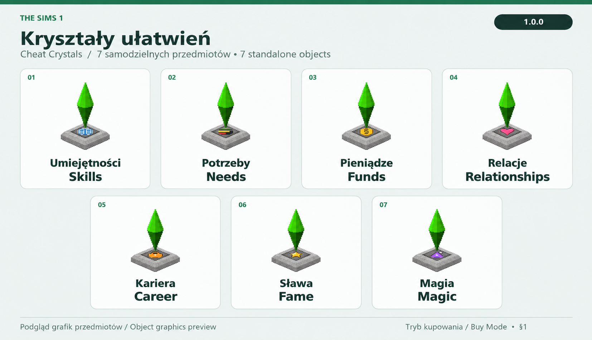

# The Sims 1 – Cristais de trapaça

[English](README.md) | [Polski](README.pl.md) | [Deutsch](README.de.md) | [Français](README.fr.md) | [Español](README.es.md) | [Italiano](README.it.md) | **Português (Brasil)**  
[Nederlands](README.nl.md) | [Dansk](README.da.md) | [Svenska](README.sv.md) | [Norsk (bokmål)](README.nb.md) | [Suomi](README.fi.md)  
[日本語](README.ja.md) | [한국어](README.ko.md) | [ไทย](README.th.md) | [简体中文](README.zh-CN.md) | [繁體中文](README.zh-TW.md)

Sete objetos animados para alterar o dinheiro da família, as necessidades, as habilidades, os relacionamentos, a carreira, a fama e os recursos mágicos. Você pode instalar o conjunto completo ou escolher os cristais desejados. Cada um custa §1 e fica no modo Compra, em Diversos → Todos (∞). Coloque o cristal no lote, selecione um Sim e clique no cristal para abrir seu menu.

## Download

**[Baixar os cristais de trapaça – GitHub Releases](../../releases/latest)**

Baixe o arquivo ZIP na seção Assets da versão mais recente. Ele contém os sete arquivos IFF e instruções em 17 idiomas. O arquivo SHA-256 pode ser usado para verificar a integridade do ZIP.

`TS1-Cheat-Crystals-*-multi.zip`

## Os sete cristais

<strong>📘 Cristal de habilidades</strong>

Ajuste cada uma das seis habilidades do nível 0 ao 10.

Arquivo: `TS1SkillsCrystal.iff`

<strong>📊 Cristal de necessidades</strong>

Ajuste, preencha, congele ou descongele as necessidades.

Arquivo: `TS1NeedsCrystal.iff`

<strong>💰 Cristal de dinheiro</strong>

Adicione ou retire simoleons ou zere o dinheiro da família.

Arquivo: `TS1FundsCrystal.iff`

<strong>💗 Cristal de relacionamentos</strong>

Altere amizades e romances ou adicione conhecidos da vizinhança.

Arquivo: `RelationshipCrystal.iff`

<strong>💼 Cristal de carreira</strong>

Escolha entre 20 carreiras e ajuste o nível de 1 a 10.

Arquivo: `TS1CareerCrystal.iff`

<strong>⭐ Cristal de fama</strong>

Ajuste a fama de 0 a 5 estrelas ou inicie ou encerre a carreira de superastro.

Arquivo: `TS1FameCrystal.iff`

<strong>🔮 Cristal de magia</strong>

Adicione moedas mágicas e ingredientes.

Arquivo: `TS1MagicCrystal.iff`

## Instalação

1. Feche o jogo e extraia o arquivo ZIP.
2. Abra a pasta da instalação do The Sims que você usa, aquela que contém `sims.exe`.
3. Copie a pasta `TS1CheatCrystals` da pasta `Downloads` do pacote para a pasta `Downloads` do jogo. Crie `Downloads` se necessário. O caminho final será semelhante a `[pasta do sims.exe]\Downloads\TS1CheatCrystals\TS1FundsCrystal.iff.` Evite criar `Downloads\Downloads.`
4. Mantenha só uma cópia de cada cristal, inclusive ao atualizar. Renomear um arquivo mantém o identificador do objeto. Deixe os arquivos `README` fora da pasta do jogo e abra o The Sims novamente.

## Desinstalação

Descongele as necessidades antes de retirar o cristal correspondente. Venda os cristais colocados nos lotes, salve a partida e feche o jogo. Em seguida, apague os arquivos IFF que quiser remover ou a pasta `Downloads\TS1CheatCrystals.` As alterações já salvas permanecem na partida.

## Compatibilidade

Esta versão foi preparada para The Sims Coleção Legacy com todas as expansões. As funções de fama usam Superstar e as funções mágicas usam Num Passe de Mágica. Os menus, as descrições e as mensagens estão disponíveis em 17 idiomas e seguem o idioma do jogo. O ZIP contém um `README` em cada um desses idiomas.

Depois de carregar uma partida, congele as necessidades novamente se quiser mantê-las fixas.

## Comentários e relatos de bugs

Encontrou um bug ou tem uma sugestão? [Abra uma issue](../../issues) e informe a versão do jogo, o idioma, a versão do mod, o cristal e os passos para reproduzir o problema.

## Aviso

Modificação não oficial criada por fãs, sem vínculo com a Electronic Arts ou a Maxis.
